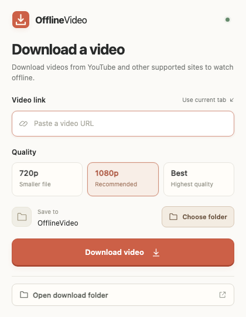

# OfflineVideo

**Download videos from YouTube and other supported sites to watch offline.**

A small Chromium extension with a local download helper for macOS. Paste a link, choose a folder and quality, and save a compatible MP4. No account, subscription, analytics, or download library.



## Install

For **macOS** with **Python 3.10+**, and a Chromium browser such as Dia, Arc, Chrome, Edge, Brave, Chromium, Vivaldi, Yandex, or Opera. Windows, Linux, Firefox, and Safari are not currently supported by the installer.

1. Download **[offlinevideo.zip](https://github.com/Artemiy729/OfflineVideo/releases/latest/download/offlinevideo.zip)** from the latest release and extract it. You can also clone this repository or download its source ZIP.
2. Open the extracted `OfflineVideo` folder and run `./install.command` in Terminal, or double-click `install.command` in Finder. The installer creates an isolated Python environment, downloads yt-dlp and FFmpeg dependencies, installs the helper into `~/Library/Application Support/OfflineVideo/runtime`, and registers it for detected browsers. It does not modify your system Python.
3. Restart your browser. Open `chrome://extensions`; in Dia, use `dia://extensions`, or `edge://extensions` in Edge.
4. Enable **Developer mode**, click **Load unpacked**, and select **`OfflineVideo/extension`**, the folder containing `manifest.json`.
5. Pin OfflineVideo to your browser toolbar.

For YouTube, install **Node.js or Deno** if neither is already available. The helper discovers supported runtimes automatically. macOS may ask for permission to run a downloaded script or access the selected folder; review the source and allow only actions you intend to perform.

Keep Developer mode enabled and the extension folder in place. This project is distributed through GitHub, not the Chrome Web Store. A browser extension alone cannot provide the local downloader: the helper installation is required.

## How it works

1. Open a video page and click OfflineVideo. The current tab's address is filled in automatically; you can paste a different link or use **Use current tab**.
2. Choose **720p**, **1080p**, or **Best** quality. These are upper limits when the site reports a resolution, not a guarantee that every quality exists.
3. Use **Choose folder** to select your destination. The preference is saved for future downloads; the default is `~/Downloads/OfflineVideo`.
4. Click **Download video**. You can close the popup while the helper continues downloading. **Open download folder** opens the selected destination in Finder.

The final file is **MP4 with H.264 video, yuv420p pixels, and AAC audio** when an audio stream exists. The downloader prefers compatible MP4 sources. If a site provides other codecs, the helper converts them in a temporary folder before placing the finished MP4 in your destination. Conversion can take time and may slightly reduce quality. Device support also depends on resolution and player capabilities.

Videos are saved directly into your chosen folder. Existing files are never overwritten; a numbered filename is used instead. An in-progress download keeps the destination that was selected when it started. Cancelling the folder picker keeps your previous choice.

## No history

There is no saved-video list and no monitoring of files that you move or delete. The popup shows only the request started in that open popup. Reopening it starts with a clean interface while an existing background download continues.

The helper temporarily stores active request state. A completion receipt is removed when the open popup receives it, or within a minute of completion. Download logs are not kept. Quality and destination preferences are saved separately. See [PRIVACY.md](PRIVACY.md) for storage locations and permissions.

## Supported sites and limits

Downloads use [yt-dlp](https://github.com/yt-dlp/yt-dlp). Support varies by site and may change when a service updates its player. A URL to a video page or a direct HTTP(S) video URL is supported where yt-dlp can extract it.

- Individual videos only: playlists and unfinished live streams are rejected.
- No DRM removal, paywall bypass, or browser-cookie extraction. Videos requiring sign-in may fail.
- This is not a guarantee of downloading from every website. Browser-only `blob:` URLs cannot be used directly; paste the video page URL.
- The installer and native integration target macOS. Other Chromium browsers share the extension package but can vary in how they support native messaging.

## Updates and removal

Update the project files and run `install.command` again to update dependencies and the installed helper. Click **Reload** on OfflineVideo's card in the browser's extension management page. Your chosen folder and quality are retained.

To uninstall, remove the extension, then delete `local.offlinevideo.json` from the `NativeMessagingHosts` directory of each browser where it was registered. The installed helper is in `~/Library/Application Support/OfflineVideo/runtime`. Removing the helper does not delete your saved videos.

## Development

The extension's frontend is plain HTML, CSS, and JavaScript and requires no build step. Python dependencies are listed in `requirements.txt`; `requirements.lock.txt` records the versions used in the validated development environment.

```sh
python3 -m venv .venv
.venv/bin/python -m pip install -r requirements.txt
.venv/bin/python -m unittest discover -s tests -v
npm install
npx playwright install chromium
npm run check
npm test
```

Checks cover real local-video downloads through a detached helper, WebM-to-MP4 conversion and decoding, cleanup of request receipts, no history in the API, folder preferences, collision-safe filenames, and responsive layouts between 280 and 900 px.

`tests/extension-smoke.cjs` checks real native messaging in an isolated browser profile after installing the helper. `OFFLINEVIDEO_BROWSER=dia` selects Dia. `OFFLINEVIDEO_TEST_POPUP=1` additionally checks the actual 400 px action popup; this requires a browser session that permits focusing a window. `OFFLINEVIDEO_SHOW_BROWSER=1` opens a visible test browser.

The editable icon is `extension/icons/icon.svg`. Run `npm run icons` to render the PNG sizes. The README preview is a controlled fixture, not a user's browser session; set `OFFLINEVIDEO_PREVIEW_PATH` when running `npm test` to regenerate it.

Create the downloadable source-and-installer bundle:

```sh
python3 scripts/package.py
```

The ZIP includes the extension, helper source, installer, documentation, and license. It excludes virtual environments, installed dependencies, local preferences, request data, and test fixtures. Dependencies are downloaded during installation, not bundled in the release.

## License

[MIT](LICENSE). yt-dlp, FFmpeg, and other dependencies retain their own licenses. OfflineVideo is an independent project and is not affiliated with YouTube, Google, or supported video services.
